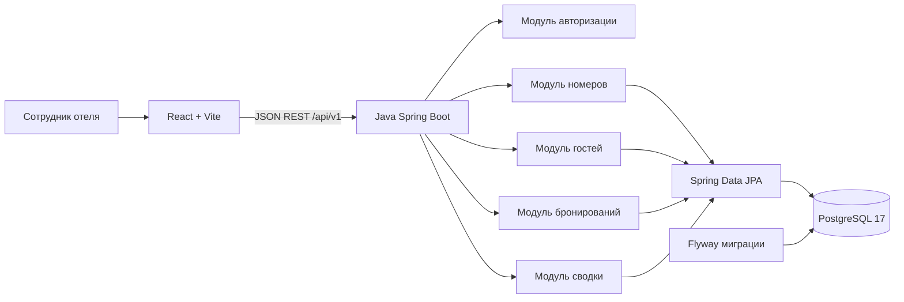

# Архитектура проекта ZEVS

Архитектура — **трёхзвенное монолитное веб-приложение**: frontend, backend и отдельная реляционная БД. Микросервисы не используются, поскольку учебная команда небольшая, а доменная модель компактная.

## Ответственность уровней

**Frontend:** интерфейс, ввод данных, сообщения об ошибках. Не содержит секретов БД.

**Backend:** REST API, валидация, ролевая модель, бизнес-правила, транзакции, расчёт стоимости.

**База данных:** сохранность сущностей, PK/FK, строгие ограничения и защита от одновременного двойного бронирования через `EXCLUDE`.

**Flyway:** контролируемые версии схемы PostgreSQL.

## Предлагаемые пакеты backend

- `auth` — вход, выход, роли;
- `rooms` — номерной фонд;
- `guests` — карточки гостей;
- `bookings` — проверка доступности, статусы и стоимость;
- `dashboard` — агрегированные показатели;
- `health` — техническая проверка работы API.

В каждой предметной подсистеме предполагаются слои `controller`, `service`, `repository`, а также DTO и сущности. Реализация подсистем — последующие задачи проекта.

## Окружение

| Компонент | Локальный адрес |
| --- | --- |
| Frontend dev server | `http://localhost:5173` |
| Backend | `http://localhost:8080` |
| PostgreSQL на хосте | `localhost:5433` |
| PostgreSQL внутри контейнера | `db:5432` |

Для frontend Vite настраивает proxy `/api` → `localhost:8080`. Приложение предназначено для **локальной учебной демонстрации**, а не для эксплуатации с персональными данными в интернете.
