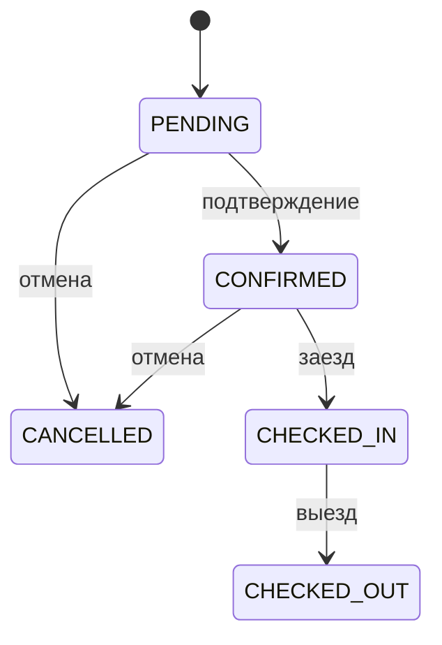

# Бизнес-правила гостиничной CRM

| ID | Правило |
| --- | --- |
| BR-01 | Номер комнаты уникален внутри гостиницы. |
| BR-02 | Дата выезда строго позже даты заезда. |
| BR-03 | Проживание задаётся полуоткрытым интервалом `[check_in, check_out)`: в день выезда допустимо новое заселение. |
| BR-04 | Для одного номера запрещены пересекающиеся бронирования, кроме броней со статусом `CANCELLED`. |
| BR-05 | Новая бронь имеет статус `PENDING`. |
| BR-06 | `PENDING` → `CONFIRMED` или `CANCELLED`. |
| BR-07 | `CONFIRMED` → `CHECKED_IN` или `CANCELLED`. |
| BR-08 | `CHECKED_IN` → `CHECKED_OUT`. |
| BR-09 | Менять даты и комнату можно в `PENDING` или `CONFIRMED` после повторной проверки доступности. |
| BR-10 | Бронь создаётся только для существующего гостя и активного номера. |
| BR-11 | Стоимость брони — число ночей, умноженное на зафиксированную цену номера за ночь. |
| BR-12 | Неактивный номер нельзя выбрать для новой брони, но история остаётся в базе. |
| BR-13 | Сотрудник `RECEPTIONIST` не может создавать или изменять номера. |
| BR-14 | Гостевые данные доступны только авторизованному персоналу. |

## Пограничные случаи

- Брони **10–12 ноября** и **12–15 ноября** не пересекаются.
- Брони **10–13 ноября** и **12–15 ноября** пересекаются и не могут сосуществовать на одном номере.
- Если первая бронь имеет статус `CANCELLED`, новый период может её перекрывать.
- Даты заезда и выезда в один день отклоняются.

## Диаграмма статусов

## Решения для подтверждения с преподавателем

Расчётная валюта — **рубли (RUB)** в демонстрационных примерах. При необходимости заказчик может определить другую валюту до начала разработки. Регистрация сотрудников выполняется администратором (без публичной саморегистрации). Для реальных персональных данных требуется отдельная проработка требований безопасности и применимого законодательства.
