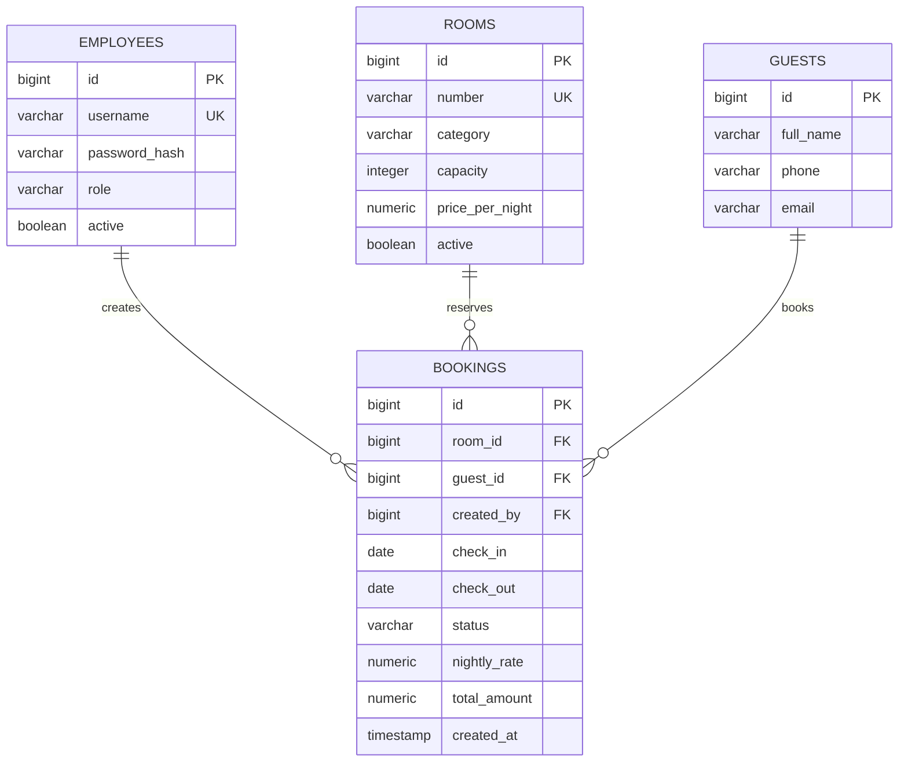

# Модель данных и ER-диаграмма

Первая целевая версия модели — четыре таблицы: сотрудники, номера, гости и брони.

## Сущности

**employees:** учётные записи персонала с ролью `ADMIN` или `RECEPTIONIST` и хешем пароля (создание пользователей в приложении пока не реализовано).

**rooms:** номер, категория, вместимость, цена за ночь, активность.

**guests:** ФИО, телефон и необязательный email.

**bookings:** связи с гостем, номером и ответственным сотрудником, даты, статус, стоимость, дата создания.

## Ключевые ограничения

1. Уникальные значения `rooms.number` и `employees.username`.
2. Вместимость `>= 1`, стоимость ночи `> 0`, итог `> 0`.
3. `check_out > check_in`.
4. Ограниченный набор значений роли и статуса.
5. Внешние ключи; удаление связанных данных не уничтожает бронь.
6. `EXCLUDE USING gist` с `daterange(check_in, check_out, '[)')` предотвращает пересекающиеся **неотменённые** бронирования одного номера даже в условиях конкуренции запросов.

